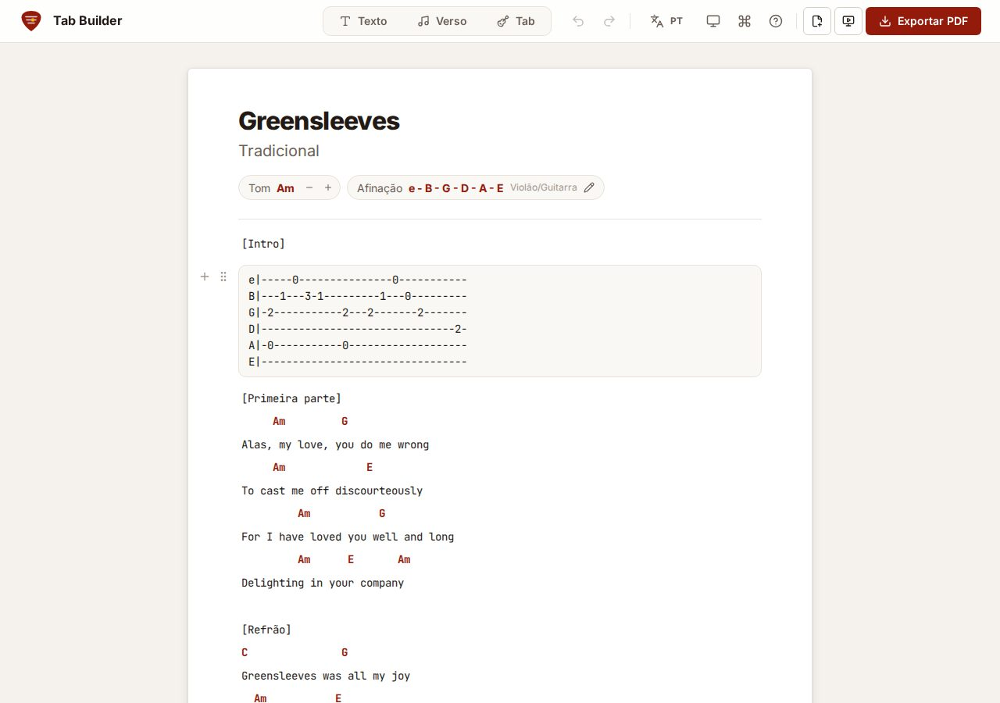
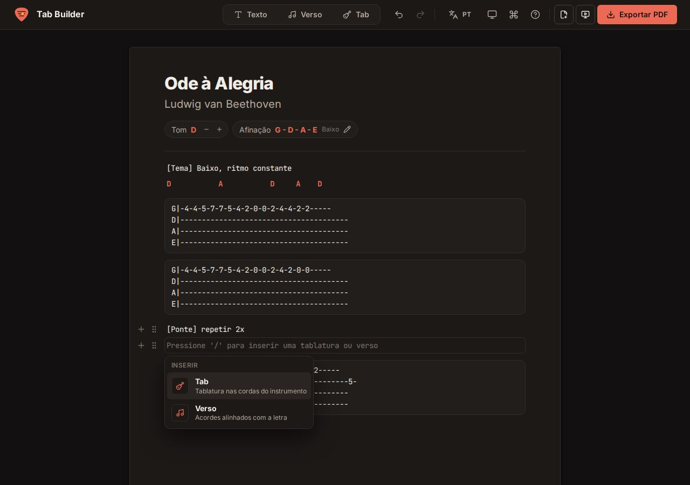
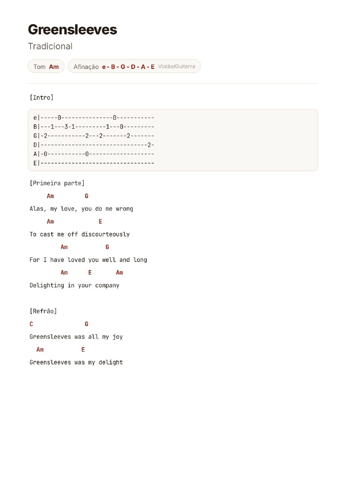
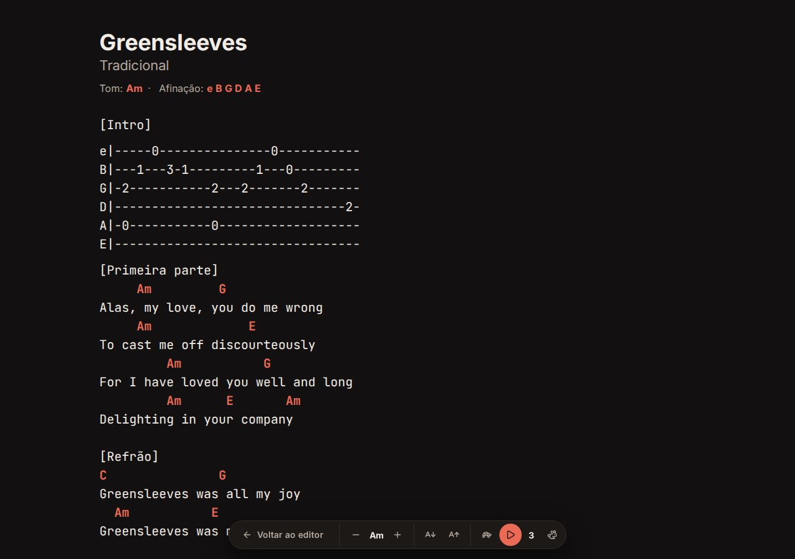
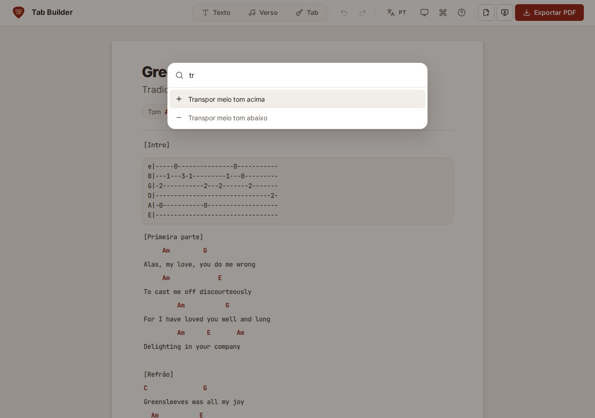
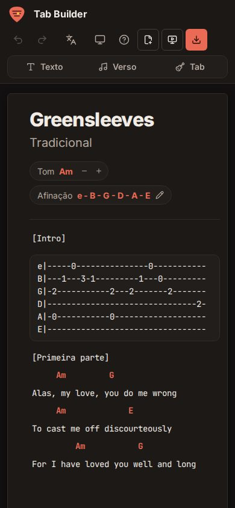

# tab builder

O Tab Builder foi criado para te ajudar a criar tabs e cifras das suas músicas. Você pode adicionar tab, versos, anotações e movê-las para outros lugares da música.

Ao final você pode gerar um PDF pronto para uso em sua pasta de músicas ou um meio eletrônico.

* Comece preenchendo os dados gerais da música, como o nome e artista
* Em seguida comece a montar sua música
* Ao final gere o PDF da sua tab

Recursos do editor:

* Blocos de texto, verso (acordes alinhados com a letra) e tab, que podem ser inseridos, duplicados, movidos e removidos
* `/` num campo de texto insere tab ou verso; `Ctrl+K` abre a paleta de comandos; `?` mostra a ajuda e os atalhos
* Desfazer/refazer (`Ctrl+Z` / `Ctrl+Shift+Z`) na música inteira
* Transposição de tom (acordes e tom) mantendo cada acorde na sua coluna
* Modo palco: tela cheia, letra grande, tema escuro e rolagem automática
* Tema claro, escuro ou do sistema
* PDF igual à folha do editor, com pré-visualização e nome do arquivo

Acervo na nuvem:

* Login com a conta Google
* "Salvar" (`Ctrl+S`) guarda a música no seu acervo; abra, busque e exclua suas cifras de qualquer lugar
* Playlists: monte repertórios com as cifras do acervo, na ordem que quiser

## :clipboard: Sumário

- [Visão Geral](#visao-geral)
  - [O problema](#o-problema)
  - [Prints](#prints)
  - [Links](#links)
- [Meu processo](#meu-processo)
  - [Construção](#construcao)
  - [O que aprendi](#o-que-aprendi)
- [Futuras implementações](#futuras-implementacoes)
- [Como executar o projeto](#como-executar-o-projeto)
  - [Banco de dados](#banco-de-dados)
  - [Backend](#backend)
  - [Frontend](#frontend)
  - [Testes](#testes)
- [Autor](#autor)

## :telescope: Visão geral

### O problema

Sou um amante de música. Desde 2012, quando comecei a tocar violão, o meu interesse só aumentou. Em 2019 comecei a tocar em uma banda com uns amigos. Nesse meio já como guitarrista.  
  
Por ser uma banda amadora, a vida vai minando o nosso tempo, e a cada show que aparecia, a formação da banda mudava. Enfim chegou a minha vez, e tive que começar a tocar baixo.

No começo foi um choque grande, pois há uma enorme diferença no conteúdo encontrado online para violão e guitarra comparado ao que se encontra para baixo. Tive que começar a desenvolver mais o meu ouvido para começar a tirar as músicas.

Nessa de tirar de ouvido, eu precisava fazer anotações. Foi quando notei que não havia uma grande plataforma ou site para criação de tabs de forma simples, que era o que eu precisava, e de forma gratuita.

Encontrei um site que oferecia justamente isso: criação de tab de forma simples e gratuita. Porém haviam algumas limitações. Ela me serviu para o que eu queria, mas logo quis fazer a minha versão com as minhas melhorias.
  
### Prints  
  
Editor, com os botões de um bloco (`+` para inserir, `⋮⋮` para arrastar ou abrir as ações):



Tema escuro, tab de baixo e o seletor aberto com `/`:



PDF gerado, igual à folha do editor:



Modo palco, com transposição, tamanho da letra e rolagem automática:



Paleta de comandos (`Ctrl+K`):



No celular:


    
### Links
 
- Projeto online: [Netlify](https://tourmaline-marigold-756eaf.netlify.app/)  
  
## :pencil2: Meu processo 
  
### Construção  
  
- Frontend:  
  - Vue 3 com TypeScript, Pinia, Vue Router e Vue I18n
  - Vite
  - html2pdf.js
  - Vue Draggable Plus
  - Reka UI (diálogos e menus acessíveis) e ícones Lucide
  - Inter e JetBrains Mono (@fontsource), design tokens em CSS custom properties
- Backend:
  - Node.js com Fastify e TypeScript
  - MongoDB (driver oficial) e validação com Zod
  - Login com Google (ID token validado no servidor) e sessão em cookie `httpOnly`
- Infraestrutura:
  - Docker e Docker Compose (MongoDB, API e Nginx)
  - VPS com Caddy compartilhado (HTTPS automático) e deploy pelo GitHub Actions
- Testes:
  - Vitest (núcleo do editor; API inteira com MongoDB em memória)
  - Playwright (E2E com uma API falsa, sem depender do backend)

A arquitetura, o modelo de dados, os endpoints e as regras de acesso estão no [SDD](./SDD.md).

```text
your-tab/
├── frontend/            o editor (Vue 3 + Vite)
├── backend/             a API (Fastify + MongoDB)
├── docker-compose.yml   produção: MongoDB + API + Nginx
├── scripts/deploy.sh    atualiza a VPS
├── DEPLOY.md            como publicar na VPS
└── SDD.md               documento de design
```

### O que aprendi

Tudo que foi usado nesse projeto foi feito com Javascript relativamente simples. Com o estudo aplicado, é possível resolver muitos problemas do nosso dia-a-dia.

A geração de pdf pode ser feita pelo front, ao invés de receber uma URL do front.

Há muitos recursos acessíveis pelo front e é possível construir muita coisa utilizando apenas o front.
  

## :satellite: Futuras implementações
  
:white_check_mark: Melhorar a tela inicial. Necessário deixar mais intuitiva e clara  
:white_check_mark: Utilização da biblioteca i18n para múltiplas linguagens   
:white_check_mark: Login, acervo de cifras e playlists  
:white_medium_square: Rota 404  

## :arrow_forward: Como executar o projeto

São três partes rodando ao mesmo tempo: o **MongoDB**, a **API** (`backend/`) e o **editor** (`frontend/`). O editor funciona sozinho, mas sem a API não há login nem acervo.

Requisitos:

- **Node.js 22** ou superior. Com o [nvm](https://github.com/nvm-sh/nvm), rode `nvm use` dentro de `backend/` ou `frontend/` (a versão está no `.nvmrc`)
- **Yarn 1** (definido em `packageManager`; com o [Corepack](https://nodejs.org/api/corepack.html) ativo a versão certa é usada automaticamente)
- **Docker**, para o MongoDB

### Banco de dados

Na primeira vez, crie o container do MongoDB (os dados ficam no volume `tab-mongo`):
```
docker run -d --name tab-mongo -p 127.0.0.1:27017:27017 -v tab-mongo:/data/db mongo:8
```

Nas próximas, basta iniciá-lo:
```
docker start tab-mongo
```

Para olhar os dados: `docker exec -it tab-mongo mongosh tab-builder`, a extensão *MongoDB for VS Code* ou o MongoDB Compass, conectando em `mongodb://localhost:27017`.

### Backend

```
cd backend
yarn
cp .env.example .env
```

No `.env`, preencha:

- `JWT_SECRET`: um segredo de pelo menos 32 caracteres (ex: `openssl rand -base64 48`)
- `GOOGLE_CLIENT_ID`: o ID do cliente OAuth do Google. Crie em *Google Cloud Console → APIs e serviços → Credenciais → ID do cliente OAuth (Aplicativo da Web)* e autorize a origem `http://localhost:5173`. Vazio, a API sobe, mas o login fica desligado

Depois suba a API em `http://localhost:3000` (ela reinicia sozinha ao editar o código):
```
yarn dev
```

Outros comandos:
```
yarn build     // compila para dist/
yarn start     // roda o build (produção)
yarn typecheck // checagem de tipos
```

O `docker-compose.yml` da raiz é o de produção (VPS, atrás do Caddy compartilhado); para publicar, veja o [DEPLOY.md](./DEPLOY.md).

### Frontend

```
cd frontend
yarn
yarn serve
```

O editor abre em `http://localhost:5173`. Em desenvolvimento, o Vite repassa as chamadas `/api` para a API na porta 3000, então front e API ficam na mesma origem, como em produção.

Outros comandos:
```
yarn build     // gera a versão de produção em dist/
yarn preview   // serve localmente o build de produção
yarn typecheck // checagem de tipos (vue-tsc); o build também roda
yarn lint      // ESLint + Prettier
```

### Testes

Backend, a API inteira contra um MongoDB em memória (não precisa do Docker nem do Google):
```
cd backend
yarn test
```

Frontend, testes unitários do núcleo do editor (`src/core`) com o [Vitest](https://vitest.dev/):
```
cd frontend
yarn test:unit
```

Frontend, testes E2E com o [Playwright](https://playwright.dev/). Eles sobem o servidor de desenvolvimento sozinhos e simulam a API, então não precisam do backend. Na primeira vez, instale o navegador:
```
npx playwright install chromium
```

Depois execute:
```
yarn test:e2e

// para acompanhar no navegador:

yarn test:e2e --ui
```
  
## :smile: Autor  
  
- Renato Novaes
  - [Linkedin](https://www.linkedin.com/in/renatonovaes49)
  - [Instagram](https://www.instagram.com/novaes_r)

## :clap: Agradecimentos  
  
* **Rafael Rodrigues** - [Linkedin](https://www.linkedin.com/in/r-a-f-a-e-l-rodrigues/) - Mestre na arte de ensino. Sempre aprendo algo novo com ele.
* **Wesley Alves** - [Linkedin](https://www.linkedin.com/in/wesley-alves-f/) - Tirou muitas dúvidas e caminhos para o desenvolvimento de funcionalidades
* **Thiago Vilasboas** - [Linkedin](https://www.linkedin.com/in/thiago-vilasboas/) - O cara que mais entende de CSS que eu conheço
